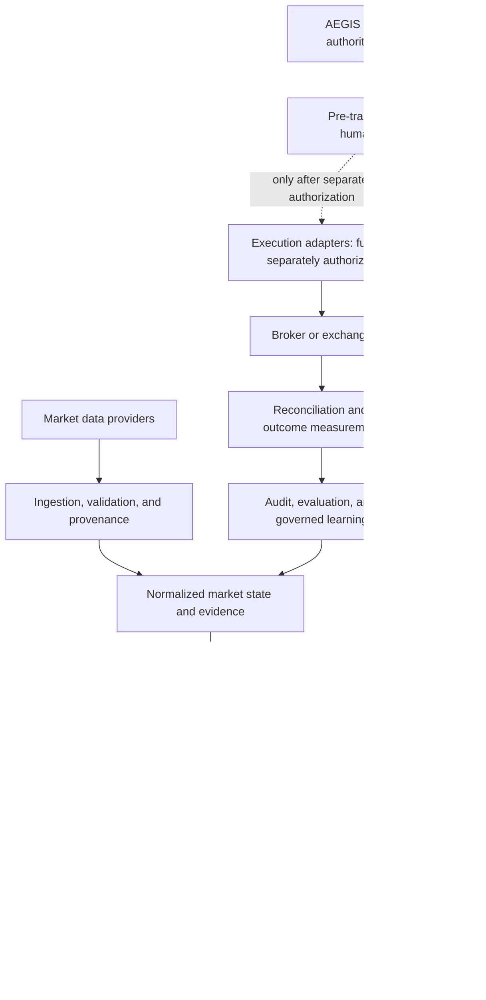

# Quantitative Research Ecosystem and Repository Review

## Status and scope

This is a **discovery and planning reference**, adapted from the user-supplied repository directory on 2026-10-13. It is not an independent source-code audit, an endorsement, or a dependency adoption decision. Repository names, descriptions, and links are carried forward as candidate references; verify the exact upstream project and its current state before review.

**No repositories have been cloned, copied into this codebase, or added as dependencies.** Sentinel's existing research prototypes remain research-only. Strategy generation does not grant trading authority, and no broker order operation is enabled by this document.

The supplied directory notes that open-source trading software varies widely: a research library, backtester, data platform, agent demo, and execution engine are not interchangeable, and none establishes profitability without independent evaluation.

## Prioritized shortlist for AEGIS/Sentinel

The focus column records the proposed investigation area from the supplied directory. All candidates remain **not reviewed**; no license, security, maintenance, performance, or architecture conclusion is implied. The supplied shortlist did not provide direct repository URLs for these entries, so exact upstream identity must be resolved as part of the review.

| Priority | Candidate | Proposed investigation focus | Review status |
|---:|---|---|---|
| 1 | QuantConnect LEAN | Trading-engine and execution abstractions | Not reviewed |
| 2 | Microsoft Qlib | Quantitative research and model evaluation | Not reviewed |
| 3 | VectorBT | Fast strategy experimentation | Not reviewed |
| 4 | Freqtrade | Crypto strategy testing, execution lifecycle, and operational controls | Not reviewed |
| 5 | Hummingbot | Market-making and exchange connectivity | Not reviewed |
| 6 | OpenBB | Financial data and research integrations | Not reviewed |
| 7 | PyPortfolioOpt | Portfolio construction and allocation | Not reviewed |
| 8 | Riskfolio-Lib | Risk-aware portfolio optimization | Not reviewed |
| 9 | TradingAgents | Multi-agent research workflow patterns | Not reviewed |
| 10 | Hodget | AI investment-team architecture; exact upstream identity needs verification | Not reviewed |

The intended outcome is to learn from well-scoped components while keeping AEGIS as the authoritative identity, authority, governance, and decision layer. Do not combine complete platforms or import code merely because it is open source.

## Broader discovery directory

The following names and categories are retained from the supplied directory as avenues for later review. The list is deliberately not exhaustive of GitHub, and inclusion does not imply compatibility or approval.

### Quantitative trading platforms and research engines

Microsoft Qlib; QuantConnect LEAN; OpenBB; VectorBT; Backtrader; Zipline Reloaded; `bt`; FinRL; Jesse; Freqtrade; StockSharp; Hummingbot.

### Hedge-fund systems, AI research, and agent workflows

Hodget; Multi-Asset Risk Platform (exact upstream identity not supplied); TradingAgents; Microsoft RD-Agent; OpenBB; Qlib; [Awesome Quant](https://github.com/wilsonfreitas/awesome-quant); Awesome Systematic Trading; Quant Developers Resources.

### Crypto research, exchange connectivity, and execution

[Freqtrade](https://github.com/freqtrade/freqtrade); [Hummingbot](https://github.com/hummingbot/hummingbot); [Jesse](https://github.com/jesse-ai/jesse); [CCXT](https://github.com/ccxt/ccxt); [FreqUI](https://github.com/freqtrade/frequi); [OctoBot](https://github.com/Drakkar-Software/OctoBot); [Freqtrade strategy examples](https://github.com/freqtrade/freqtrade-strategies); [Awesome Crypto Trading Agents](https://github.com/shakeebshaan/awesome-crypto-trading-agents).

### Backtesting, indicators, portfolio construction, and reporting

VectorBT; Backtrader; Zipline Reloaded; TA-Lib; pandas-ta; QuantStats; PyPortfolioOpt; Riskfolio-Lib; empyrical-reloaded; FinRL.

### Market data, broker APIs, and multi-asset systems

OpenBB; CCXT; Alpaca Python SDK; Interactive Brokers TWS API; yfinance; VectorBT; StockSharp; LEAN. Provider terms, market-data licensing, entitlement, latency, survivorship bias, and corporate-action methodology require separate review.

### DeFi, on-chain analytics, and market structure

Uniswap V3 Core and Periphery; Aave V3 Core; Flashbots; MEV-Inspect; Brontes; DeFiLlama; Hummingbot; DeFi research directories; MEV project directories. Smart-contract risk, gas, liquidity, MEV competition, and failed transactions can invalidate apparent opportunities.

### Discovery indexes

- [GitHub quantitative-finance topic](https://github.com/topics/quantitative-finance)
- [Awesome Quant](https://github.com/wilsonfreitas/awesome-quant)
- [GitHub hedge-fund repository search](https://github.com/search?q=hedge+fund&type=repositories)
- [GitHub AI trading-agent search](https://github.com/search?q=AI+trading+agent&type=repositories)
- [GitHub trading-strategy backtesting search](https://github.com/search?q=trading+strategy+backtesting&type=repositories)
- [GitHub crypto/DeFi trading search](https://github.com/search?q=crypto+DeFi+trading+bot&type=repositories)

Indexes are discovery aids, not validation of every repository they surface.

## Proposed AEGIS/Sentinel target flow

This is a **future target architecture**, not an implementation claim. In particular, execution remains out of scope until independent governance, security, and human-approval requirements are satisfied.

### Non-negotiable boundary

> Strategy generation must not equal trading authority.

Research agents may produce evidence-backed assessments or proposals. Independent server-side policy, permissions, position and loss limits, and any required human approval determine whether a consequential action is authorized. Agent consensus, a candidate label, backtest output, or client-side state is not authorization. Learning from outcomes must not automatically relax risk constraints or increase authority.

## Repository due-diligence matrix

Complete this review **before** adopting code, adding a dependency, or relying on a repository's claimed behavior. Capture a pinned commit or release and the date of review; do not assess a project solely from its README or a demonstration.

| Review dimension | Evidence to record |
|---|---|
| Identity and scope | Canonical upstream URL, repository owner, pinned commit/release, intended problem, and whether it is a library, platform, demo, or execution engine |
| License and obligations | SPDX identifier, notices, transitive licenses, linking/distribution obligations, commercial-use constraints, and compatibility with Sentinel's distribution |
| Maintenance | Recent release/commit history, maintainer responsiveness, bus factor, governance, support policy, and unresolved deprecations |
| Security and supply chain | Advisories, dependency health, install/build scripts, secrets handling, permissions, sandbox assumptions, release provenance, and supported vulnerability-reporting process |
| Tests and reproducibility | Test scope, CI status, deterministic behavior, seeded randomness, pinned inputs, coverage of failure paths, and reproducible results |
| Performance and correctness | Workload-matched benchmark method, hardware/data assumptions, correctness checks, memory/latency profile, and independent replication; do not infer performance from project claims |
| Data and venue constraints | Data licensing, entitlement, adjustments, point-in-time integrity, survivorship/look-ahead risks, broker/exchange terms, and venue-specific behavior |
| Architecture fit | Compatibility with Sentinel's typed ports, model-agnostic logic, trusted-plugin boundary, and AEGIS authority; conflicts, duplication, and migration cost |
| Decision | Study only, adapt an interface, port a narrowly scoped idea, adopt a dependency, defer, or reject—with rationale, owner, and review date |

Initial tracking status for every shortlisted candidate: **not reviewed**. Repository-specific adoption recommendations must not be filled in until the checks above are supported by current evidence.

## Integration rule

Prefer learning from an upstream design or implementing a narrow adapter behind Sentinel's existing provider-neutral contracts over importing a full platform. Any future code adoption requires a separate, recorded license, security, maintenance, performance, and architecture review. Execution-related code additionally requires a separate threat model, explicit authority model, independent risk controls, and approved operational scope.
